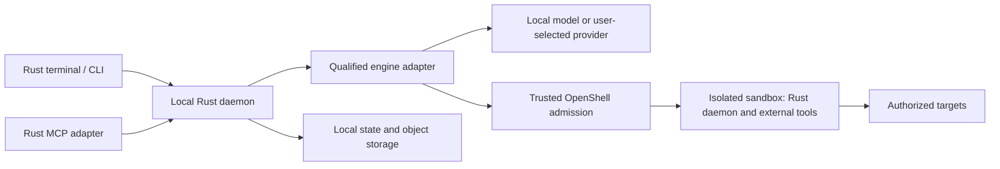

# Proposed local-first Rust architecture

Status: proposed design, 2026-11-16. The user requested design and research
only. This document does not select or implement an engine, replace a supported
deployment, approve a migration, or claim a released Rust product.

Evidence: [OSS/storage/framework investigation](../research/2026-11-16-agent-storage-frameworks.md).
Existing requirements: [extension contract](extension-contract.md),
[engagement sessions](engagement-session-contract.md),
[host integration](host-integration.md) and [release policy](../../RELEASE.md).

## Product boundary

The target is an OSS product whose first-party production application code is
Rust: launcher, TUI, agent execution integration, local state, model adapters,
knowledge service, sandbox daemon and browser/web runners. Python, Node and Go
are not required to run this first-party control plane. Testing and migration
tools are a separate development/distribution concern.

This definition permits external system components such as SQLite, Linux,
Chromium, OCI engines, scanners and local model servers. SQLite is implemented
in C and Chromium is not Rust. Requiring every transitive component and every
security utility to be Rust would be a different product, including replacing
the execution environment. A Rust port does not make a Kali image tiny.

Local-first means the installation owns execution and durable data without an
account, license check, hosted database, cloud scheduler or vendor telemetry.
A user can choose a local model endpoint or their own remote provider. Remote
inference sends selected context to that provider; local-first alone does not
make that mode offline. Fully disconnected inference requires a locally
available model and weights. Target-facing work still requires access to its
authorized environment.

The initial target is one operator installation, with concurrent engagements
and sessions. Multi-user SaaS tenancy, distributed scheduling, live multi-device
editing and automatic cloud synchronization are outside this design. Each
engagement keeps its own runtime and authorization identity.

## Processes and ownership



One installed CLI executable can provide `start`, `attach`, `daemon`, `mcp`,
`doctor`, backup and migration entry points. A separate sandbox executable runs
inside the isolated workload. Reusing Rust crates must not collapse those
process and privilege boundaries.

The local daemon owns workspace registration, execution handles, approved
policy, credential references, scheduled work and event observation. A TUI is
a client: closing it does not kill an engagement. Keep the current distinction
between preparing services and actually starting an assessment.
`start --background` remains preparation, not an implicit execution request.

Default local control uses a user-owned Unix socket with filesystem permissions
and peer identity checks. Windows-native named-pipe transport is a later
qualification target; the first Windows execution target is WSL2. An optional
authenticated loopback HTTP/SSE adapter serves compatibility clients. No LAN
listener or browser-hosted dashboard is required for ordinary local use.

## Framework adoption and custom-engine fallback

Maturity comparable to the current stack is a release constraint. Evaluate
released, pinned versions of Rig, Goose and ADK-Rust against the concrete gates
below. Do not equate a provider SDK, coding-agent application, graph library
and durable agent harness just because each exposes tools.

| Route | Use when | Cost that must remain visible |
| --- | --- | --- |
| Adopt an existing framework | Its released execution path passes the lifecycle, recovery, authority and provider gates | Adapters, domain porting, storage integration and upstream API changes |
| Reuse provider/protocol libraries and build a bounded Rust framework | No candidate meets the contract without replacing much of its internals | Ownership of execution semantics, checkpoint compatibility, failure recovery and maintenance |
| Continue the existing engine during qualification | The replacement has not passed | A transitional mixed-language system; this is not the completed Rust product |

The eventual product ships one authoritative execution path. Evaluation
adapters are not a commitment to maintain four interchangeable production
engines. An adapter must preserve step boundaries, typed suspension, child
identity, cancellation and persistence. An adapter that only sends a prompt
and returns text is insufficient.

For a custom framework, implement a narrow execution kernel over established
runtime/storage libraries: a serializable run state machine, typed effects,
durable suspension, child dispatch/join and explicit reducers. Keep model
wire implementations, MCP and terminal rendering reusable. Do not build a new
database, inference engine, generic workflow language or universal plugin ABI.
Decepticon's OPPLAN, artifact and evidence rules remain product domain logic;
the kernel provides their execution mechanism. Scope both efforts separately
so the framework is not declared mature because the product demo completes.

Logical Rust modules are contracts, engine integration/kernel, local storage,
providers, sandbox transport, knowledge, daemon and clients. Start with shared
crates plus the host/sandbox binaries; split packages where dependency or
privilege boundaries justify it. All authority enforcement runs outside
replaceable prompt and knowledge components.

## Storage: navigable files and transactional execution

Use SQLite on a local filesystem for execution/authority records and ordinary
files for knowledge, work products and large evidence. The model interacts
through file tools, bounded search and domain operations, not arbitrary SQL.
This recommendation is an inference from Decepticon's concurrent revisions
and recovery needs, supported by the [comparative research](../research/2026-11-16-agent-storage-frameworks.md).

| Data | Authority | Human-facing representation |
| --- | --- | --- |
| Installed skills, role prompts, workflow catalogs | Versioned local files; each execution pins selected bytes and hash | Markdown/YAML, editable for future sessions |
| Approved RoE and tool grants | Operator-owned scope file plus trusted admission/authority records | Read-only approved scope and inspectable policy summary |
| Messages, run steps, questions, decisions, effects, checkpoint continuation | Transactional local database | Transcript, JSONL export and status commands |
| OPPLAN, artifact IDs/revisions, verification and completion receipts | Single authoritative domain commit through the daemon/engine | Markdown/JSON projections and explicit edit/import operations |
| Raw evidence, captures and large outputs | Immutable content objects referenced by committed hashes | Exportable files with provenance |
| Long-term lessons and notes | Scoped files with separately protected provenance and revision metadata | Searchable Markdown; suggestions do not become authority |
| Search indexes, embeddings and generated summaries | Derived caches with source hashes | Rebuild/status commands |
| Provider secrets | OS credential store or explicitly supplied encrypted secret store | Opaque references; never injected into the sandbox |

Do not maintain independently writable DB and file versions of the same
execution truth. The framework's checkpoint blob, where used, is persisted
through its supported checkpointer contract. Product status is committed at
that boundary; a second scheduler must not infer progress from a projection.
The design must verify whether a candidate can share a transaction with domain
changes. Otherwise use an explicit recoverable commit/outbox protocol and
retain an intermediate state; do not claim an atomic commit across two stores.

A proposed engagement layout is:

```text
engagement/
  .decepticon/             # host-only; never mounted into the workload
    state.sqlite
    objects/sha256/
    runtime-manifest.json
  plan/                   # approved scope; generated OPPLAN views
  notes/                  # scoped, editable working memory
  recon/
  findings/
  evidence/               # exported/raw evidence views
  report/
```

The control directory is not inside the sandbox mount view. Named data mounts
or explicit subdirectory binds expose only the approved workspace surfaces.
The existing `/workspace` view can be retained inside the workload. Never bind
the engagement parent wholesale and expect a hidden directory name to protect
the database or credentials. Stable workspace UUIDs, not display names or host
paths, identify registered engagements.

For large objects: stage bytes, flush, atomically publish the immutable object,
then commit its reference and event in SQLite. A crash can leave an unreferenced
object; it must not leave a committed pointer to unpublished content. Rendered
Markdown and JSONL exports are retryable projections carrying the committed
revision. External edits are new candidates checked against their base revision;
they do not silently change completed findings or approved scope. Consistent
backup covers both the DB snapshot and every object it references.

WAL permits concurrent readers but still has one writer, and requires a local
shared-memory environment. Use short write transactions, bounded writer queues,
busy handling, foreign keys, deliberate durability settings and consistent
backup. A network share or synchronized folder is not a supported live database
location. [SQLite WAL documentation](https://sqlite.org/wal.html).

## Knowledge, memory and graph reasoning

Preserve path-based skill loading and role visibility. Start with exact
identifiers, directory navigation, grep and local FTS search. Optional local
embeddings can improve paraphrase retrieval; no cloud embedding provider is
required. Summaries remain pointers to evidence, not replacements for it.

Separate notes about observations from validated facts and operator
instructions. Record source session, role, evidence hash, time, scope and trust
class outside model-authored prose. Cross-engagement learning requires explicit
promotion with target identifiers/secrets removed. Recalled content cannot
authorize tools, widen RoE or count as independent verification. Memory edits
have history and conflicts; deleting a search index must not erase provenance.

For the default local graph, use typed node/edge tables with engagement-scoped
indexes and bounded Rust traversal or recursive queries. SQLite supports
[recursive graph queries](https://sqlite.org/lang_with.html), but that does not
make it Cypher/APOC compatible. Existing Neo4j algorithms, legacy IDs, graph
ingest, constraints and reporting queries need explicit porting and differential
tests. An optional Neo4j connector can remain for existing large deployments.
Replacing Skillogy's retrieval ranking also requires a retrieval evaluation;
FTS and Neo4j/Lucene scores are not interchangeable.

## Durable execution contract

Keep workspace, engagement, conversation/thread, operator turn, run attempt,
child invocation, tool call and event identities distinct. A new operator turn
gets a new step budget; question answers and time-window continuation retain
their existing turn. The daemon assigns scheduled-turn identities explicitly.

Persisted states include ready/running, waiting for a question or approval,
waiting for an execution window, waiting for a child, paused, completed,
cancelled and failed. An uncertain external action is recorded on its effect
and leaves the run needing reconciliation. It is not a successful completion.
Conversation-only replies do not finalize an assessment.

Each model/tool boundary records the intended effect, identity, authorization
revision and resulting receipt. Before dispatch, recheck current scope,
admission, time window and tool grant. Commit state and its durable event before
acknowledging completion. Token deltas may be transient; message/tool outcomes,
questions, approvals, child results and terminal status must be durable.

An external side effect and a local database commit cannot be made one atomic
transaction. If a process dies after a command may have executed but before
its result is saved, reconnect to its owned job when possible; otherwise mark
the outcome unknown. Never automatically repeat a potentially mutating action
because an HTTP stream, process or model turn ended. An effect key prevents
local duplicates; it is not an exactly-once guarantee from an arbitrary target.

One authoritative writer applies OPPLAN/artifact mutations per engagement.
Specialists can execute concurrently with distinct invocation IDs and isolated
scratch areas. They return versioned results and evidence references. Reducers
accumulate distinct results, reject conflicting immutable pins and validate
ownership/revision. Completion order cannot discard another child's receipt.
Preserve finding-specific proof, independent verification and report criteria.

Observer clients resume from durable event sequence IDs. Reconnecting joins
an existing execution and never reposts the starting prompt. An answered
question is consumed once against its original identity and authority revision.
Detach, pause, cancel and stack shutdown remain separate operations. Restart
reconciles unfinished jobs and rechecks authority before resuming execution;
restoring a checkpoint is not a fresh approval.

## Models, tools and isolation

Connect to user-selected provider APIs directly through Rust adapters; LiteLLM
is optional compatibility infrastructure. Preserve streaming tool-call IDs,
structured schemas, reasoning/content blocks, model routing, fallbacks, context
compaction and usage accounting. Select tools before model dispatch using the
current role and policy. Budget estimates must be labeled when the provider
does not supply authoritative usage; a configured hard budget cannot silently
claim that unknown usage is zero. Local inference still needs token, time and
resource caps even when its monetary cost is zero.

OpenShell remains the target-execution boundary. Port the trusted admission
adapter and session bridge to Rust against a pinned gateway protocol, with real
qualification. The engine holds no raw Docker socket and target-facing file,
shell, browser and network operations remain inside the admitted workload.
No default host-shell or plain-HTTP fallback may bypass admission. Preserve
the approved-document hash, effective policy hash, complete binding identity,
acknowledged renewal, daemon ownership and background-job identity.

The Rust sandbox daemon initially retains tmux behavior: sessions, markers,
bounded logs, input, auto-background, polling and cancellation. Replacing tmux
with a native PTY can be a later independently qualified change. Replace
Python-generated filesystem scripts with explicit Rust filesystem operations.
Port browser and acquisition orchestration too; a standard HTTP client does
not establish parity with curl impersonation and browser escalation. External
browser/curl binaries may remain without retaining first-party Python/Node
runners. Reuse existing tool binaries rather than rewriting scanners.

## Extensions and local privacy

Keep portable skills/workflows as data and Rust library composition for trusted
embedded extensions. Use versioned MCP subprocess/transport contracts for
runtime tools, with scoped grants and isolated execution where appropriate.
Do not make unstable Rust dynamic-library ABI the public plugin contract.
An optional WASM mechanism needs a concrete requirement before adoption.

Python entry points and `decepticon_sdk.host` cannot retain callable-level
compatibility in a Python-free process. Offer a new Rust SDK and explicit
host/tool wire contracts. Any temporary Python adapter is labeled migration
compatibility and excluded from the final Rust-native installation profile.
Preserve explicit override precedence and non-overridable authority checks.

Optional Python in-process agent packages, including the Blue capability,
need their own port or an explicitly qualified out-of-process protocol adapter.
Their current availability is not inherited automatically by the Rust engine.

Telemetry is off by default in this proposed local-first profile. A collector,
if retained, is an optional separately distributed Rust service; the existing
TypeScript Worker is not required by the new installation. No automatic
upload of notes, transcripts, evidence, credentials or failure reports. This is
a behavior change from the current installed-product consent defaults and
requires release documentation. Local diagnostics, explicit export and selected
provider requests are separate operations. Database files need restrictive
permissions and inherit the user's disk-encryption protections; this design
does not claim full database encryption merely because secrets use a keychain.

## Docker remains a supported deployment

Rust changes what runs inside an image, not whether OCI deployment is possible.
Provide native-host and Compose distributions from the same Rust code and
state format. The default local mode runs the operator application natively
and keeps the offensive execution environment isolated.

| Current component | Proposed local default | Proposed Compose mode |
| --- | --- | --- |
| Python LangGraph service | Rust daemon + qualified engine integration/kernel | Rust control-plane image |
| Go launcher + Node/Ink CLI | Rust CLI/TUI binary | Same Rust CLI on host or an optional TTY client container |
| Required LiteLLM route | Direct Rust provider adapters; gateway optional | Optional existing gateway profile |
| PostgreSQL for gateway state | Local state/usage records; no DB server required | Optional legacy gateway DB; not the Rust execution store |
| Neo4j and Skillogy | Embedded knowledge/search and ported graph operations | Optional compatibility connector/profile |
| Python sandbox daemon and runners | Rust sandbox executable in managed workload | Rust executable in the operational image |
| Separate time-window resumer | Durable local daemon timer | Timer in Rust control plane |
| Kali/tooling/Chromium/OpenShell | Retained external execution infrastructure | Retained and pinned images/protocols |

The default Compose topology has a Rust control plane, a separately privileged
trusted admission gateway and dynamically managed sandbox workloads. Gateway
certificate/bootstrap jobs are separate lifecycle steps. Do not run a second
unconfined daemon as an implicit backup. Optional C2, reversing and other
tooling workloads keep their existing isolation boundaries.

Build Rust binaries in a pinned multi-stage build; run control-plane containers
as an unprivileged user with read-only roots where supported. Choose a runtime
base that supplies required certificates and system libraries; “Rust” does not
imply `scratch` is always correct. The operational image still contains the
external tools and their own language runtimes. Image-size and cold-start
improvements must be measured separately for each image.

Persist the host control data on a local bind mount or local named volume.
Mount workspace, state, secrets and gateway data separately. Compose recreating
a container must not reset conversations. Default control ports stay unpublished;
the optional HTTP compatibility listener binds loopback and requires local
credentials. Only the admission infrastructure receives the compute socket.

Linux/WSL2 are the first qualification lane. macOS needs a Linux VM/container
runtime for the execution substrate; Windows-native packaging needs separate
IPC, terminal, path and secret-store qualification. Docker Desktop/Podman
networking and OpenShell nesting must be tested on the actual platform; a
successful Rust cross-compile does not establish that support.

## Migration, backup and rollback

1. Pin and back up the old install, workspaces, execution volume and graph
   before changing deployment manifests. Preserve immutable released images.
2. Export through the trusted old runtime/API into a versioned neutral bundle:
   messages, plans, workflow source pins, artifact revisions, raw-evidence hashes,
   graph IDs/edges, usage and provenance. Never load an arbitrary received
   pickle file. The transitional exporter may require the old Python runtime.
3. Import into a new location, validate references, preserve old-to-new IDs and
   produce a loss/unsupported-field report. The Rust importer never treats
   transcript text, imported host paths or a historical approval as authority.
4. Keep old conversations readable. Completing active old runs under the old
   runtime is the safest default; exact mid-node cross-engine continuation is
   unqualified. Starting a new Rust attempt from reviewed artifacts is explicit.
5. Re-admit workspaces and re-provision secrets, migrate schedules disabled,
   then validate campaign/fresh-thread behavior before enabling them. A local
   scheduler runs only while its daemon/machine is available; default missed
   ticks are skipped rather than launching a backlog of assessments on wake.
6. Switch launch/default image only after the parity gates pass. Keep rollback
   artifacts and backup instructions. Binary/image rollback and data rollback
   are different: an older engine must refuse a newer incompatible state schema.
   Restore a compatible backup or use a supported reverse migration; do not
   point both engines at the same writable state store.

Backup is local and self-contained, with an explicit option to include secrets.
Export/import supplies portability first; a live SQLite file is not a sync
protocol. No CRDT or distributed lock service is needed for the initial product.

## Acceptance gates and delivery order

Every framework candidate, including a custom kernel, faces the same gates:

| Gate | Required observation |
| --- | --- |
| Basic parity | Direct-scope Red, optional Plan, registered specialists, supported tools, skills and pinned workflows work on an owned local target |
| Parallel work | Two concurrent invocations of the same role retain distinct transcripts/effects; conflicting revisions fail; no child evidence is lost |
| Durable suspension | Question/approval survives process restart; an answer is consumed once; changing scope invalidates stale authority |
| Crash recovery | Kill at model/tool/commit boundaries; saved results are reused; uncertain side effects are reconciled without blind re-execution |
| Cancellation and observation | Detach/attach, pause/resume, cancel, same-volume restart and cursor continuation preserve identity and terminal status |
| Confinement | No-scope, foreign workspace, changed policy, expired/invalid admission, denied egress and revoked grants are refused before execution |
| Provider parity | Required provider wires stream tools correctly, partial failures remain attributable, secrets stay scoped, compaction/fallback do not bypass policy |
| Storage and upgrades | Backups restore on a clean install; interrupted writes recover; selected framework upgrades have a tested state-format migration or explicit drain/archive path |
| Local-first deployment | Local-model mode starts without cloud services; native and Compose pass the same lifecycle cases and preserve data across replacement |
| Product quality | Same task/model/fixtures as the old engine; measure task success, evidence validity, token use, latency, idle/peak memory and operational burden |

Define a non-inferiority margin and confidence/sample plan before comparing
task success; do not choose a favorable threshold after seeing results. No
feature checklist or upstream test count substitutes for these observations.

Delivery is ordered by evidence: freeze contracts and fixtures; qualify a
framework or decide the bounded custom-kernel scope; port contracts and local
storage; qualify the sandbox/authority boundary; deliver one vertical agent
flow with restart and question resume; extend domain tools, knowledge and
parallel coordination; qualify both distributions; then migrate and switch.
The initial Rust vertical slice is not described as equivalent maturity.

Production acceptance requires local tests, rendered desktop/TUI flow checks,
real owned-target runs and measured native/container behavior. GitHub Actions
being unavailable does not waive these gates. This design-only PR contains no
such replacement qualification and makes no claim of a completed port.
